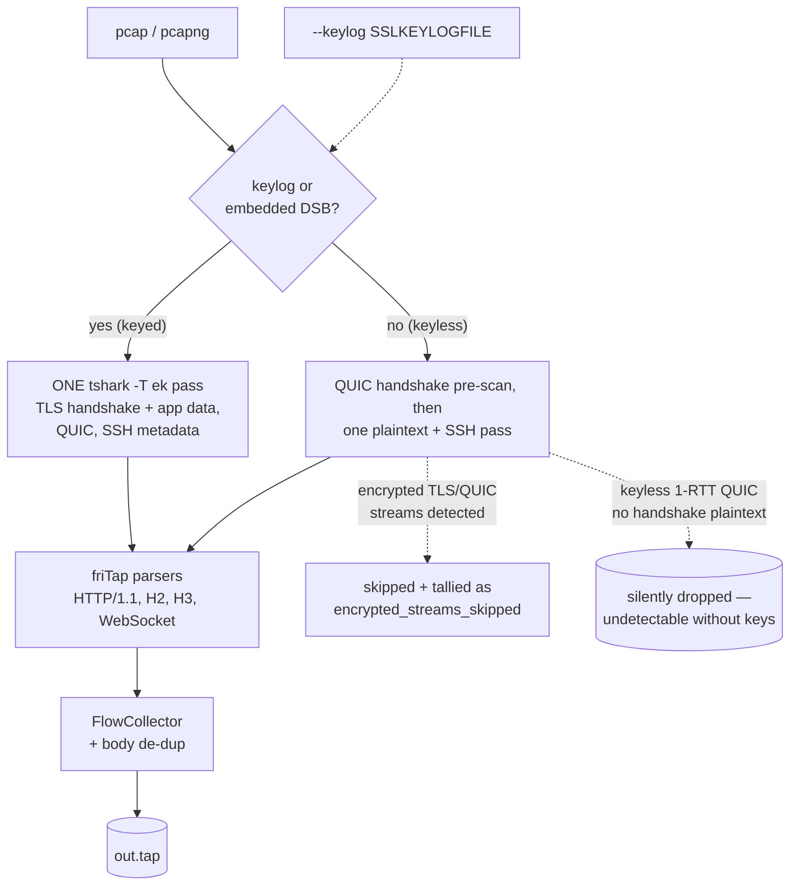

# Offline pcap → .tap conversion

friTap can reconstruct a friTap `.tap` file from a capture you already have on
disk — no live target, no Frida attach. This is the *offline* path: you bring a
`pcap`/`pcapng` (and, when the traffic is encrypted, the TLS keys), and friTap
produces the same rich `.tap` you would get from a live capture, ready for
[`fritap analyze`](traffic-analysis.md) and the [replay TUI](../getting-started/tui.md).

!!! warning "Requires Wireshark / tshark ≥ 4.x"
    Every example on this page shells out to **tshark** (the Wireshark CLI) to
    dissect and — when keys are available — decrypt the capture. tshark is **not**
    bundled with friTap and is **not guaranteed to be installed**. Install
    Wireshark (`brew install wireshark`, `apt install tshark`, or
    [wireshark.org](https://www.wireshark.org/)). If tshark is not on your `PATH`
    (common on macOS, where it lives in `Wireshark.app`, and on Windows), point
    friTap at it with `--tshark-path` or the `$FRITAP_TSHARK` environment
    variable. tshark **< 4.0** is accepted but warns: QUIC field names may be
    unstable.

If you just want the 5-minute happy path, start with the
[Offline quickstart](../getting-started/offline-quickstart.md) and come back here
for the details, caveats, and the Python API.

---

## What it does

The offline pipeline has two distinct modes, chosen automatically from the inputs:

- **tshark-decrypt (keyed).** When you pass `--keylog` *or* the capture is a
  `pcapng` carrying an embedded **Decryption Secrets Block (DSB)**, friTap drives
  tshark to decrypt the TLS and QUIC streams, then feeds the recovered plaintext
  through friTap's own protocol parsers (HTTP/1.1, HTTP/2, HTTP/3, WebSocket, …)
  to build flows.
- **Plaintext ingest (keyless).** When you pass *no* keys and there is *no* DSB,
  friTap treats the capture as already-cleartext and ingests the raw transport
  payload (`tcp.payload` / `udp.payload`) directly. Streams that are *genuinely*
  encrypted are detected, skipped, and tallied (see
  [Caveats](#caveats-read-before-you-trust-the-output)).

In both modes the result is the same `.tap` format used everywhere else in
friTap — see the [.tap format spec](../api/tap-format.md).



With keys, friTap runs **one** `tshark -T ek` pass per conversion (display
filter `tls.handshake || tls.app_data || quic || ssh`). It yields the TLS
handshake metadata, the decrypted TLS application data, the QUIC metadata and
stream data, and the SSH banners/KEXINIT. Earlier releases ran five separate
passes. The resulting `.tap` is the same, and that separate-pass code has been
removed. Without keys, a QUIC handshake
pre-scan finds the genuinely encrypted QUIC streams. A second pass then reads
the plaintext payload and the SSH metadata together. friTap's own raw-TCP
decryptors (MTProto, standalone RC4, mid-stream TLS) do not use tshark; they
read the capture with a fast built-in pcap parser (see
[Raw-TCP decryptors and the pcap parser](#raw-tcp-decryptors-and-the-pcap-parser)).

---

## CLI: `--from-pcap`

The offline pipeline is invoked through the main `fritap` entry point whenever
`--from-pcap` appears in the arguments. It owns a small, dedicated set of flags:

```bash
# requires Wireshark/tshark ≥ 4.x
fritap --from-pcap chrome.pcap --keylog chromekeys.log --tap out.tap
```

| Flag | Purpose |
| --- | --- |
| `--from-pcap <file>` | **Required.** The capture file (`pcap` or `pcapng`). |
| `--keylog <file>` | NSS `SSLKEYLOGFILE` used to decrypt TLS/QUIC. Omit for a plaintext capture or a DSB-embedded `pcapng`. |
| `--tap <file>` | Output `.tap` path. Defaults to `<pcap stem>.tap`. |
| `--scan` | Run the analyzers over the produced `.tap` and report a finding count. See [Traffic analysis](traffic-analysis.md). |
| `--tls-port <port>` | Custom TCP port to Decode-As TLS. Repeatable. |
| `--quic-port <port>` | Custom UDP port to Decode-As QUIC. Repeatable. (443 is always included.) |
| `--decode-as <rule>` | Raw tshark `-d` Decode-As rule, passed through verbatim. Repeatable. |
| `--tls-heuristic` | Enable tshark's TLS-over-TCP heuristic dissection (finds TLS on non-standard ports without an explicit `--tls-port`). |
| `--tshark-path <path>` | Path to the tshark binary. Else auto-discovered (also honors `$FRITAP_TSHARK`). |
| `--repair-keylog` | Before converting, re-pair `--keylog` secrets whose `client_random` matches no handshake in the capture (e.g. keys dumped from Schannel/lsass) by trial decryption. On a match it writes `<keylog stem>.repaired.keylog` next to the keylog and decrypts with it; otherwise the original keylog is used. |

!!! tip "Direction labelling on non-standard ports"
    friTap labels `write` (client→server) vs `read` (server→client) by the
    **server port**. For correct direction on a non-standard TLS port you must
    pass that server port via `--tls-port`; otherwise friTap falls back to
    "whoever sent application data first is the client".

This page documents only the offline sub-flags. For the complete `fritap` flag
reference, see [CLI reference](../api/cli.md).

---

## Manifest sidecar: `<pcap>.fritap.json`

A live friTap capture writes a sidecar manifest next to the pcap so that an
offline reconstruction can find the keys and ports automatically. If a file named
`<pcap>.fritap.json` sits beside your capture, friTap reads it and fills in any
value you did **not** pass on the command line.

```json
{
  "keylog": "chromekeys.log",
  "tls_ports": [4433, 8443],
  "quic_ports": [8443]
}
```

Recognized keys: `keylog`, `tls_ports`, `quic_ports`. A missing or unreadable
manifest is treated as empty (no error).

**Precedence — explicit always wins:**

```
CLI flag  >  manifest value  >  built-in default
```

So `--keylog other.log` overrides the manifest's `keylog`, but if you omit
`--keylog` the manifest's value is used. The same holds for `--tls-port` /
`--quic-port`.

---

## Keyed vs keyless behavior

| | **Keyed** (`--keylog` or DSB) | **Keyless** (no keys) |
| --- | --- | --- |
| What is read | Decrypted TLS app-data + decrypted QUIC stream data | Raw `tcp.payload` / `udp.payload` of an already-plaintext capture |
| Encrypted streams | Decrypted into flows | Detected, **skipped**, and counted as `encrypted_streams_skipped` |
| Missing `--keylog` file | **Fails loud** — `NoDecryptionKeysError` (exit 5). A typo'd key path is never silently masked as "plaintext". | n/a |
| TLS/QUIC handshake metadata | SNI, ALPN, cipher, version enriched onto flows | SNI/version still recoverable from plaintext handshake; cipher/ALPN need keys |

The "fail loud" rule matters: if you pass `--keylog` but the file does not exist
(and there is no DSB), friTap stops with `NoDecryptionKeysError` rather than
falling through to the plaintext path and producing a misleading `.tap`.

---

## MTProto (Telegram)

tshark **cannot** decrypt Telegram's MTProto, so friTap ships its own decryptor
(TCP reassembly → AES-CTR transport de-obfuscation → AES-IGE record decryption).
It runs alongside the TLS/QUIC passes when you pass `--mtproto-keylog`:

```bash
fritap --from-pcap tg.pcapng --mtproto-keylog tg.keys --tap tg.tap
```

* `--mtproto-keylog` is **separate** from `--keylog` — the latter is the NSS/TLS
  key log handed to tshark; the former is friTap's MTProto key log
  (`MTPROTO_AUTH_KEY` lines) consumed by friTap's own decryptor. They can be
  combined on a mixed capture.
* Offline decryption needs the AES backend, which ships in friTap's base install
  (no extra needed); the optional `tgcrypto` fast path is pulled in automatically
  where a wheel exists. On a lean install the backend is absent and the CLI prints
  `Warning: Telegram/MTProto decryption needs an extra dependency …` and **skips**
  the MTProto streams — the TLS/QUIC passes still complete.
* Decrypted MTProto message bytes land in an `MtprotoLayer` in the `.tap`. friTap
  does not parse the Telegram TL schema; that is left to a pluggable parser (see
  [Telegram (MTProto)](../protocols/telegram.md)).

### Graceful-degradation counters

When MTProto streams are present, the summary adds counters that tell you what
could **not** be decrypted (the decryptor never emits garbage — it skips and
tallies):

```text
  mtproto messages:  128
  mtproto undecryptable records: 4 (no matching auth_key — temp/perm key mismatch?)
  mtproto degraded streams: 1 (capture started mid-stream / unsupported transport)
```

* **`mtproto undecryptable records`** — a record's `auth_key_id` matched no key in
  the keylog. Usually a **temp/perm key mismatch**: the keylog was not recorded
  during the same session as the pcap (Telegram's PFS rotates the temp key).
* **`mtproto degraded streams`** — a stream could not be processed end-to-end:
  the capture **started mid-stream** and no obfuscated-transport CTR state was
  available to seek the counter into it, or it used a transport friTap does not
  yet support (e.g. Fake-TLS, padded intermediate). A mid-stream capture is **not**
  fatal when memory scanning (`-ms`) is on: the scanner's Tier E recovers the live
  obfuscated-transport AES-CTR state from memory, and the offline decryptor seeks
  that counter into the capture (`recover_obf_alignment`), so already-open
  connections decrypt without the first 64 bytes. This needs the connection alive
  during a scan pass, some recent traffic captured (alignment anchors within
  roughly ~64 KB of the live counter), and the transport AUTH key — which the same
  scan recovers.

---

## Schannel (Windows lsass secrets)

The Schannel memory-scan engine recovers TLS 1.2 masters and TLS 1.3 secrets
from `lsass.exe`, but not the client random. It writes them **unpaired** to a
`<memscan-keylog-stem>.schannel.unpaired` sidecar. Pass that sidecar with
`--schannel-unpaired`. friTap then trial-decrypts each secret against the
capture to find its connection, writes a derived NSS keylog next to the
sidecar, and decrypts the paired TLS flows:

```bash
fritap --from-pcap win.pcapng --schannel-unpaired capture.schannel.unpaired --tap win.tap
```

Each sidecar line is:

```text
<kind> <secret_hex> <session_id|-> <ssl_version> [group=<id>]
```

* `kind` is `schannel_tls12_master` or `schannel_tls13_secret`, and
  `ssl_version` is `771` (TLS 1.2) or `772` (TLS 1.3).
* The optional **5th column** `group=<id>` (a bare token is accepted too) ties
  the secrets of one connection together. An unlabeled TLS 1.3 secret is
  placed as `EXPORTER_SECRET` **by elimination**: its group's connection must
  already have all four decryptable labels placed (client/server handshake and
  traffic secrets), and it must be the only secret of that group left.
  `EXPORTER_SECRET` protects no records, so trial decryption alone can never
  place it. The current agent build does not write the `group` column yet, so
  sidecars without it parse exactly as before. Secrets that could not be placed
  are logged with a count.

**Trial decryption in Python.** A Python oracle decides most trials without
spawning tshark. It decrypts a stream's first encrypted record with the
candidate secret. For TLS 1.2 it handles the AES-GCM and ChaCha20-Poly1305
suites. For TLS 1.3 it uses the handshake and traffic-secret anchors and
follows KeyUpdates. tshark still decides CBC suites, TLS 1.0/1.1 and every
stream the oracle cannot decide cleanly (for example a duplicate client random
or a degraded stream). Set `FRITAP_SCHANNEL_ORACLE=0` to send every trial to
tshark, as before. The oracle needs the `cryptography` backend; without it,
friTap falls back to tshark automatically. `--repair-keylog` uses the same
correlation.

---

## Raw-TCP decryptors and the pcap parser

friTap's own decryptors for MTProto, standalone RC4 and mid-stream TLS
reassemble TCP themselves. They share **one** parse of the capture per
conversion. Captures larger than `FRITAP_PCAP_CACHE_MAX_MB` are parsed once
per decryptor.

The parse uses a fast built-in pcap/pcapng reader that decodes the link, IP and
TCP headers itself. It hands rare packets back to scapy one at a time: tunnels,
PPPoE/LLC/MPLS, IPv6 extension headers, IPv4 options, malformed headers and
unknown link types. Set `FRITAP_PCAP_PARSER=scapy` to use the old full-scapy
parser instead.

!!! note "Intended differences from the scapy parser"
    The two parsers produce the same segments except in two places, both
    deliberate:

    * **BSD loopback IPv6 is decoded.** On NULL/LOOP link types (0, 108), the
      address families 2/0 (IPv4) and 24/28/30/10 (IPv6) are decoded on every
      platform. Each IPv6 family counts only when the packet's IP version
      nibble matches. Big-endian NULL headers are byte-swapped. Other families
      are skipped. scapy decodes only the host platform's own IPv6 value, so a
      macOS loopback capture read on Linux used to lose its `::1` connections.
    * **Ethernet padding is not payload.** scapy attached the link-layer
      padding of a short frame (e.g. a bare ACK) to the empty TCP segment as
      payload, which added phantom zero bytes to reassembled streams. The fast
      parser returns an empty payload.

    Link type 14 is treated as raw IP on every platform. Simple packet blocks
    in pcapng carry no timestamp and get time `0.0`.

---

## Environment variables

| Variable | Default | Effect |
| --- | --- | --- |
| `FRITAP_TSHARK` | unset | Path to the tshark binary. Checked after `--tshark-path` / `tshark_path=` and before `PATH`; `TSHARK_PATH` is accepted too. A value that is not executable is ignored with a warning. |
| `FRITAP_PCAP_PARSER` | fast parser | `scapy` selects the old full-scapy pcap parser for the raw-TCP decryptors (see [above](#raw-tcp-decryptors-and-the-pcap-parser)). Any other value uses the fast parser. |
| `FRITAP_PCAP_CACHE_MAX_MB` | `256` | Largest capture (in MB) whose TCP parse is shared across the raw-TCP decryptors of one conversion. `0` disables sharing. Non-numeric or non-finite values fall back to the default. |
| `FRITAP_SCHANNEL_ORACLE` | enabled | `0` disables the Python trial-decryption oracle of the Schannel correlation (`--schannel-unpaired`, `--repair-keylog`), so tshark decides every trial. |
| `FRITAP_DISABLE_OFFLINE_DECRYPTOR_DISCOVERY` | unset | Any value other than empty, `0`, `false` or `False` disables discovery of drop-in and entry-point (`fritap.offline_decryptors`) offline-decryptor plugins. Built-in decryptors stay registered. |
| `FRITAP_NO_TSHARK_VERSION_CACHE` | unset | Any value other than empty or `0` disables the on-disk cache of `tshark --version` (a JSON file in `$XDG_CACHE_HOME/fritap`, else the user cache dir). Results are still cached in memory per process. The cache is keyed by the binary's real path, modification time and size, so an upgraded tshark is queried again. |

---

## Caveats (read before you trust the output)

!!! danger "Keyless captures have hard, silent limits"
    The keyless plaintext path is best-effort. Three behaviors will surprise you
    if you do not know them.

    **1. Keyless 1-RTT QUIC is undetectable — and silently dropped.**
    To tell a *genuinely encrypted* QUIC stream apart from friTap's own decrypted
    HTTP/3 (which also rides on UDP/443), friTap looks for a handshake marker: a
    QUIC `ClientHello` or a long-header Initial bearing a registered QUIC version.
    A capture that begins **mid-connection** (1-RTT only, no handshake) carries
    **no such plaintext marker**, so tshark cannot classify it and friTap cannot
    distinguish it from raw payload. Such streams are **silently skipped** — they
    appear in neither the flows nor the `encrypted_streams_skipped` tally. *To
    capture this traffic you need the keys* (`--keylog` or a DSB pcapng).

    **2. Encrypted streams are skipped and tallied.** In the keyless path, any
    TLS/QUIC stream that *does* carry a recognizable encrypted record is skipped
    (it would need keys) and counted in `ConvertResult.encrypted_streams_skipped`.
    The CLI prints a hint:
    ```text
    Warning: no plaintext application data was produced; 3 stream(s) look
    encrypted (TLS/QUIC) and were skipped. This capture needs keys — pass
    --keylog <SSLKEYLOGFILE>, or use a pcapng with an embedded Decryption
    Secrets Block (DSB).
    ```

!!! note "Synthetic, metadata-only flows"
    SSH connections (banners + KEXINIT) are **plaintext** and need no keys, but
    friTap cannot recover the encrypted SSH payload. These — along with
    HTTP/2 control frames and similar control-plane traffic — surface as
    **synthetic, metadata-only flows**: a flow record carrying the handshake
    metadata (client/server version, KEX, cipher, MAC) but no body. They are
    purely additive; a failure here never aborts the conversion.

!!! info "Body de-duplication"
    Reconstructed request/response bodies are **de-duplicated** when written to
    the `.tap`: a body that is fully recoverable from its chunks is stored with a
    `body_from_chunks` flag and **no** duplicate blob, then rebuilt on read via
    `Flow.request_body` / `Flow.response_body`. This is transparent — it only
    matters if you parse the raw `.tap` yourself (see the
    [.tap format spec](../api/tap-format.md)).

---

## Exit codes

`fritap --from-pcap` returns:

| Code | Meaning |
| --- | --- |
| `0` | Success — decrypted/ingested application data was written. |
| `2` | pcap not found. |
| `3` | tshark could not be located (install it or pass `--tshark-path`). |
| `4` | Ran successfully but produced **no** application data (usually wrong keys/ports, or an encrypted keyless capture). A warning explains which case applies. |
| `5` | No decryption keys — `--keylog` was given but missing, and there is no embedded DSB (`NoDecryptionKeysError`). |
| `1` | Any other conversion failure (e.g. tshark exited non-zero). |

---

## Python API: `pcap_to_tap()`

The same conversion is available programmatically. Import it from the **friTap
package root** (it is intentionally *not* re-exported from `friTap.offline`,
where it would shadow the `pcap_to_tap` *module*):

!!! warning "Requires Wireshark/tshark ≥ 4.x"
    `pcap_to_tap()` shells out to tshark exactly as the CLI does. The same
    installation/`--tshark-path` notes apply (`tshark_path=` argument).

```python
from friTap import pcap_to_tap   # NOT from friTap.offline

result = pcap_to_tap(
    "chrome.pcap",
    keylog_path="chromekeys.log",   # omit for a plaintext / DSB capture
    tap_path="out.tap",             # default: <pcap stem>.tap
    tls_ports=(4433,),              # extra Decode-As TLS ports
    quic_ports=(),                  # extra Decode-As QUIC ports (443 always on)
    extra_decode_as=(),             # raw tshark -d rules
    heuristic=False,                # TLS-over-TCP heuristic dissection
    run_scan=False,                 # run analyzers afterward
    capture_target="",              # label stored in the .tap (default: basename)
    tshark_path=None,               # explicit tshark binary; else auto-discovered
    use_manifest=True,              # honor a <pcap>.fritap.json sidecar
    protocol_keylogs={              # keylogs for friTap's own offline decryptors
        "mtproto": "tg.keys",
    },
)

print(result.to_dict())
```

`pcap_to_tap()` is the manifest-aware wrapper (CLI > manifest > defaults). For a
no-manifest core call, use `friTap.offline.pcap_to_tap.convert_pcap_to_tap()`.

`protocol_keylogs` maps an offline-decryptor protocol name to its keylog path.
It covers the built-in decryptors (`mtproto`, `telegram`, `signal`, `rc4`,
`schannel`) and any registered plugin. It is the generic form of the CLI's
per-protocol flags (`--mtproto-keylog`, `--schannel-unpaired`, …). The older
`<protocol>_keylog=` keywords (e.g. `mtproto_keylog="tg.keys"`) still work: each
is folded into `protocol_keylogs` under its leading protocol token, and an
explicit `protocol_keylogs` entry wins. A keylog that is given but missing is
logged, and that decryptor is skipped.

`resync_search_depth` sets the maximum lag search when a mid-stream flow is
re-aligned to a memory-recovered key. friTap forwards it only to decryptors
whose registry entry names the receiving keyword (`resync_param`; MTProto and
Telegram use `obf_max_blocks`). `None` keeps each decryptor's own default.

It returns a `ConvertResult`:

| Field | Meaning |
| --- | --- |
| `tap_path` | Path to the written `.tap`. |
| `flow_count` | Number of flows reconstructed. |
| `decrypted_packet_count` | Application-data packets ingested (0 → exit code 4 on the CLI). |
| `stream_count` | Distinct streams observed. |
| `dropped_packet_count` | QUIC packets dropped (e.g. misaligned stream id / payload lists). |
| `dropped_stream_count` | TLS streams that could not be followed/decoded. |
| `findings_count` | Findings, when `run_scan=True`. |
| `encrypted_streams_skipped` | Encrypted streams skipped in the keyless path. |
| `per_protocol` | Per-protocol counters keyed by protocol prefix (`mtproto`, `telegram`, `signal`, `rc4`, plugins …); each bucket holds `messages`, `streams`, `undecryptable`, `degraded`, `partial`, `short`, `unknown_key_ids`, … |
| `mtproto_messages`, `mtproto_streams`, `mtproto_records_undecryptable`, `mtproto_streams_degraded` | **Deprecated.** Read-only aliases of `per_protocol["mtproto"]` (`messages`, `streams`, `undecryptable`, `degraded`; 0 when absent). They stay in `to_dict()` for compatibility. Read `per_protocol` instead. |

`ConvertResult.to_dict()` gives a JSON-safe view for web/API callers.

### Flow and connection ids

Every flow id is `<connection id>:<sequence>`. The connection id uses the first
tier that applies:

| Tier | Format | When |
| --- | --- | --- |
| client random | `cr:<protocol>:<client_random>` | The connection's client random is known. |
| session id | `sid:<protocol>:<session token>` | A real session token is present, e.g. `sid:telegram_e2e:telegram_e2e:<fingerprint>` for a Secret Chat. |
| endpoints (TLS) | `net:<4-tuple>` | TLS connections without either of the above. This is the historical format. |
| endpoints (other) | `net:<protocol>:<canonical 4-tuple>` | Every other protocol, e.g. `net:mtproto:…`, `net:quic:…`, `net:rc4:…`, `net:signal:…`. |

The 4-tuple is `lo-hi`: the two `addr:port` endpoints, sorted, so both directions
give the same id. The canonical form also normalizes IPv6 spellings (no
brackets, no zone id, compressed). Because the endpoint tier is scoped by
protocol, a decrypted inner protocol (for example RC4 or Signal inside TLS)
always gets its own flow, apart from the TLS flow on the same 4-tuple. Captures
converted before friTap 2.3.0 used `net:<4-tuple>` for every protocol, and
`sid:rc4:rc4:…` / `sid:signal:signal:…` for RC4 and Signal. Existing `.tap`
files keep those ids.

### Display filters on converted captures

* `tls` matches a flow whose transport is TLS or that has a TLS layer. A
  session id alone no longer counts, so Telegram Secret-Chat (`telegram_e2e`)
  flows, which store `telegram_e2e:<fingerprint>` in that slot, no longer
  match `tls`. They still match `telegram` and `telegram_e2e`.
* `tls.session_id` is empty for non-TLS flows.
* `quic.library` (`QuicLayer.library`) holds the hooked TLS/QUIC library of a
  **live** QUIC flow, like `tls.library`. Offline QUIC flows never carry a
  library, so it is empty there.

`pcap_to_tap()` raises `NoDecryptionKeysError` (a `ValueError`) when the capture
is encrypted and no keys are available; other tshark/IO failures propagate as
their native exceptions.

---

## See also

- [Offline quickstart](../getting-started/offline-quickstart.md) — the 5-minute happy path.
- [Telegram (MTProto)](../protocols/telegram.md) — offline `--mtproto-keylog` decryption.
- [Traffic analysis](traffic-analysis.md) — `fritap analyze` / `--scan`.
- [Replay TUI](../getting-started/tui.md) — open a `.tap` interactively.
- [.tap format spec](../api/tap-format.md) — the on-disk format.
- [CLI reference](../api/cli.md) — every `fritap` flag.
